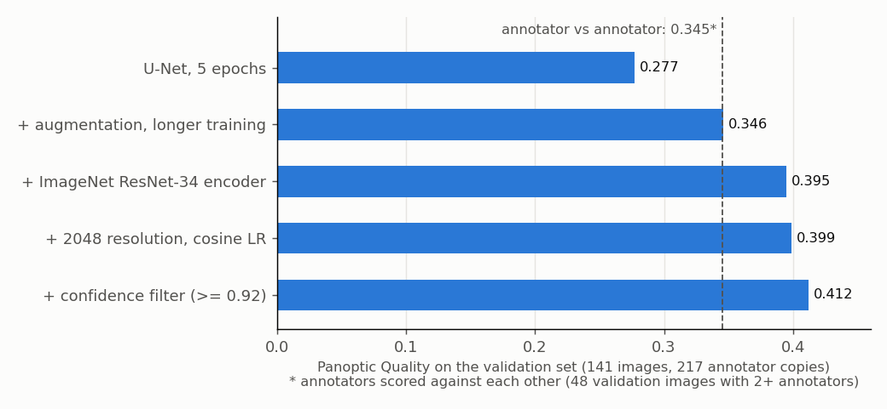
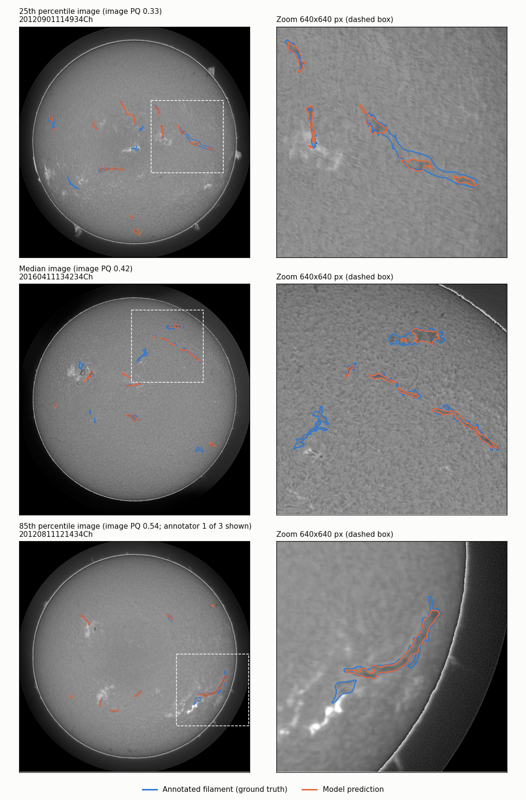
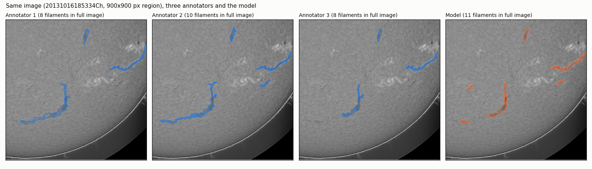

# Solar filament segmentation on GONG H-alpha images

Segmenting solar filaments (dark, thread-like plasma structures above the solar surface) in full-disk
H-alpha images, for the Kaggle [Solar Filament Segmentation Challenge 2026](https://www.kaggle.com/competitions/filament-segmentation-2026/overview).
A U-Net with an ImageNet-pretrained ResNet-34 encoder, trained at the original 2048x2048 resolution on a
MacBook Pro (M1), reaches **Panoptic Quality (PQ) 0.41** on a held-out validation set, which is
**higher than human annotators reach when scored against each other (0.345)**.



## Data

[MAGFiLO](https://doi.org/10.1038/s41597-024-03876-y) (Manually Annotated GONG Filaments in H-alpha Observations), Kaggle 2026 release:

- 707 training images (2048x2048 grayscale JPEG, GONG network, 2011-2022) with 1,154 annotation sets:
  296 images were annotated independently by 2 or 3 people, each copy is a complete annotation.
- 8,199 filament polygons, median 7 per image. Filaments cover ~0.3% of the pixels; the thinnest are ~3 px wide.
- 180 unlabelled test images.

**Validation split:** 20% of the image *files* (141 files, 217 annotator copies), seed 42, grouped by file
so copies of the same image never appear on both sides. Each prediction is scored against every annotator copy.

## Metric

The competition metric is **Panoptic Quality**, scored per filament: a prediction matches a ground-truth
filament when their IoU > 0.5.

PQ = sum of IoU over matches / (TP + 0.5 FP + 0.5 FN) = SQ (mean IoU of matches) x RQ (detection F1).

`evaluate.py` implements this locally, plus a post-processing sweep and an error breakdown.

## Method

| Part | Choice | Where |
|---|---|---|
| Model | U-Net decoder on an ImageNet-pretrained ResNet-34 encoder (24.5M parameters); the first layer's three colour filters are summed into one grayscale filter | `resnet_unet.py` |
| Input | Original 2048x2048 resolution; random 512x512 training crops, 80% placed on a filament | `dataset.py` |
| Augmentation | Flips and 90-degree rotations (image + mask), brightness/contrast jitter | `dataset.py` |
| Loss | BCE + soft Dice (Dice counters the 0.3% foreground) | `losses.py` |
| Optimiser | Adam, LR 1e-3, 2-epoch warm-up then cosine decay to 1e-6, 80 epochs, batch 4 | `main.py` |
| Training run | ~4.1 min/epoch on an M1 (MPS), 5.5 h total; best validation IoU 0.531 at epoch 78 | `train_class.py` |
| Inference | 512x512 tiles with 128 px overlap, linearly blended into one 2048x2048 probability map | `tiling.py` |
| Post-processing | Threshold 0.4 -> connected components -> pieces within 61 px grouped into one filament -> drop filaments < 250 px or with mean probability < 0.92 | `evaluate.py`, `deliverables/predict.py` |

Experiments are tracked with MLflow (parameters, git commit, per-epoch metrics and timing). Training
saves a resume checkpoint every epoch (`python main.py --resume checkpoints/<run>_last.pt`).

## Results

Validation set, best post-processing setting per model (threshold / grouping / min area):

| Step | PQ | SQ | RQ | TP / FP / FN |
|---|---|---|---|---|
| U-Net from scratch, 1024 px, 5 epochs | 0.277 | 0.633 | 0.437 | 680 / 839 / 913 |
| + augmentation, longer training (best epoch 26) | 0.346 | 0.652 | 0.532 | 851 / 758 / 742 |
| + ImageNet ResNet-34 encoder (1024 px) | 0.395 | 0.661 | 0.598 | 996 / 742 / 597 |
| + 2048 resolution, cosine LR schedule | 0.399 | 0.670 | 0.595 | 1035 / 851 / 558 |
| + confidence filter (mean probability >= 0.92) | **0.412** | 0.672 | 0.613 | 977 / 615 / 616 |

Recall by filament size (area at 2048x2048):

| Model | < 500 px | 500-1500 px | 1500-5000 px | >= 5000 px |
|---|---|---|---|---|
| ResNet-34, 1024 px | 0.443 | 0.629 | 0.698 | 0.634 |
| ResNet-34, 2048 px | **0.543** | 0.655 | 0.698 | 0.620 |

The pretrained encoder mainly fixed fragmentation: the number of filaments split into several predictions
fell from 125 to 79 at the same setting. Training at full resolution recovered small filaments (+0.10 recall)
and sharpened outlines (SQ 0.661 -> 0.670), but added false positives, so PQ rose only slightly.



*Validation images at the 25th, 50th and 85th percentile of per-image PQ (not best cases). The top zoom
shows the most common error: one long filament covered by several separate pieces.*

### Comparison with human annotators

296 training and validation images were annotated by 2 or 3 people. Scoring each annotator's copy against
the others with the same PQ metric shows how much the labels themselves disagree:

| On the 48 validation images with 2+ annotators | PQ | SQ | RQ |
|---|---|---|---|
| Annotator vs annotator (208 ordered pairs) | 0.345 | 0.629 | 0.548 |
| Model (2048, before the confidence filter) | **0.397** | 0.668 | 0.594 |

Over all 296 multi-annotator images, annotator-vs-annotator PQ is 0.340. Annotators often disagree on outlines
(matched filaments overlap with IoU 0.63 on average) and on whether a structure is one filament or two
(43 splits and 43 merges between annotator pairs on these 48 images). A model trained on all copies learns
something close to their consensus, so it lands nearer to each annotator than another annotator does.



### Error analysis (2048 model, best setting before the confidence filter)

- **False positives (851):** 50% overlap a real filament but miss the IoU 0.5 cut-off (69% of those cover
  less than two-thirds of the filament, i.e. only part of its length); 47% overlap no annotated filament;
  2% are extra fragments of a filament that was found.
- **By position on the disk:** recall is similar in the centre (0.66, r < 0.7 R) and further out (0.62,
  0.7-0.9 R), but false positives per annotated filament are about twice as high further out
  (276 per 338 vs 559 per 1,247), where limb darkening makes the background darker.
- **Confidence:** correct and false predictions have similar mean probability (median 0.96 vs 0.94), but
  dropping predictions below 0.92 removes 236 false positives for 58 lost matches (+0.014 PQ).

### What did not help (kept as documented negative results)

| Idea | Result | Why |
|---|---|---|
| Test-time augmentation (8 flips/rotations) | +0.001 PQ | The model is trained with the same 8 orientations and already predicts almost identically in each |
| Predicting in 1024 tiles instead of 512 | 0.398 vs 0.399 | More context at inference does not change what a model trained on 512 crops predicts |
| Growing predictions outward by 1 px | 0.399 -> 0.378 | Predictions are already the right width; they fall short in length, not width |
| Hysteresis thresholding (0.4 seeds grown into 0.1-0.3) | 0.398 | Split filaments have real gaps where the model is confident, not weak sections |
| Ensemble of the 1024 and 2048 models | 0.399 | Both models make the same mistakes: the remaining errors are systematic |

## Running it

```bash
pip install -r deliverables/requirements.txt
# data: put the Kaggle files in MAGFiLO_1.0_Kaggle_2026/ (train/ and test/, as downloaded)

python main.py                                   # train (settings in the config dict in main.py; ~5.5 h on an M1)
python main.py --resume checkpoints/<run>_last.pt
python evaluate.py --sweep                       # validation PQ for a grid of post-processing settings + error breakdown
python evaluate.py --save-probs probs/<run>      # save probability maps once...
python evaluate.py --sweep --load-probs probs/<run>              # ...and re-score them without the model
python deliverables/predict.py --checkpoint checkpoints/<run>.pt # test images -> submission.csv
python deliverables/export_weights.py checkpoints/<run>.pt deliverables/weights/resnet34_unet_2048.pt
python deliverables/make_figures.py              # regenerate the figures in this folder
```

`submission.csv` has one row per predicted filament: `filament_id` (`<image name>_<n>`) and `segmentation_rle`
(pycocotools RLE counts of the 2048x2048 mask). Check the ID format against the official sample submission
before submitting. Exported half-precision weights (49 MB instead of 295 MB) give the same filaments, apart
from the rare filament whose mean probability sits right at the 0.92 cut-off.

## Project layout

| File | Purpose |
|---|---|
| `main.py` | Configuration, model/optimizer/scheduler setup, MLflow run, `--resume` |
| `train_class.py` | Training loop: tiled validation, best/last checkpoints, early stopping, timing |
| `dataset.py` | Masks from COCO polygons, filament-aware crops, augmentation, file-grouped split |
| `unet.py`, `resnet_unet.py` | U-Net from scratch; U-Net with pretrained ResNet-34 encoder |
| `tiling.py` | Overlapping, blended tile prediction |
| `losses.py` | BCE + Dice loss |
| `evaluate.py` | Local PQ evaluation, post-processing sweep, error breakdown, saved/ensembled probability maps |
| `check_masks.py`, `annotations.py` | Visual checks of masks and annotations |
| `deliverables/` | This README, inference script, weight export, figures, requirements |

## Limitations

- All post-processing settings (threshold, grouping, minimum area, confidence cut-off) were chosen on the
  same validation set they are reported on, so the final numbers are slightly optimistic. The confidence
  cut-off is the most sensitive: PQ is 0.41 for cut-offs between 0.91 and 0.94, but falls to 0.33 at 0.96.
- One validation split; training is not seeded, so run-to-run variation is not measured.
- The resolution and learning-rate schedule changed in the same run, so their individual effects are not separated.
- Test-set labels are not available; no test score is reported.

## Possible next steps

- Train on soft labels (the fraction of annotators marking each pixel) to learn the consensus directly.
- Limb-darkening correction and per-image normalisation (false positives are twice as frequent towards the limb).
- Larger training crops (768 px) at full resolution, to give the model more context about filament continuity.
- Self-supervised pretraining on unlabelled GONG H-alpha images.
